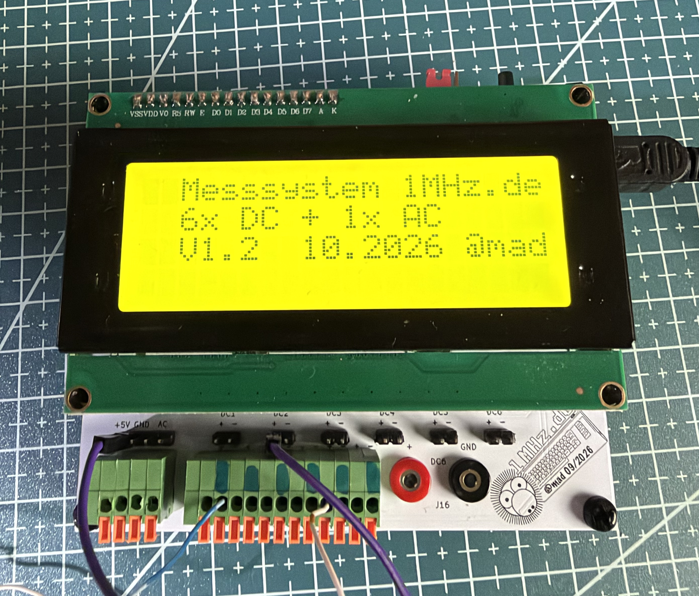
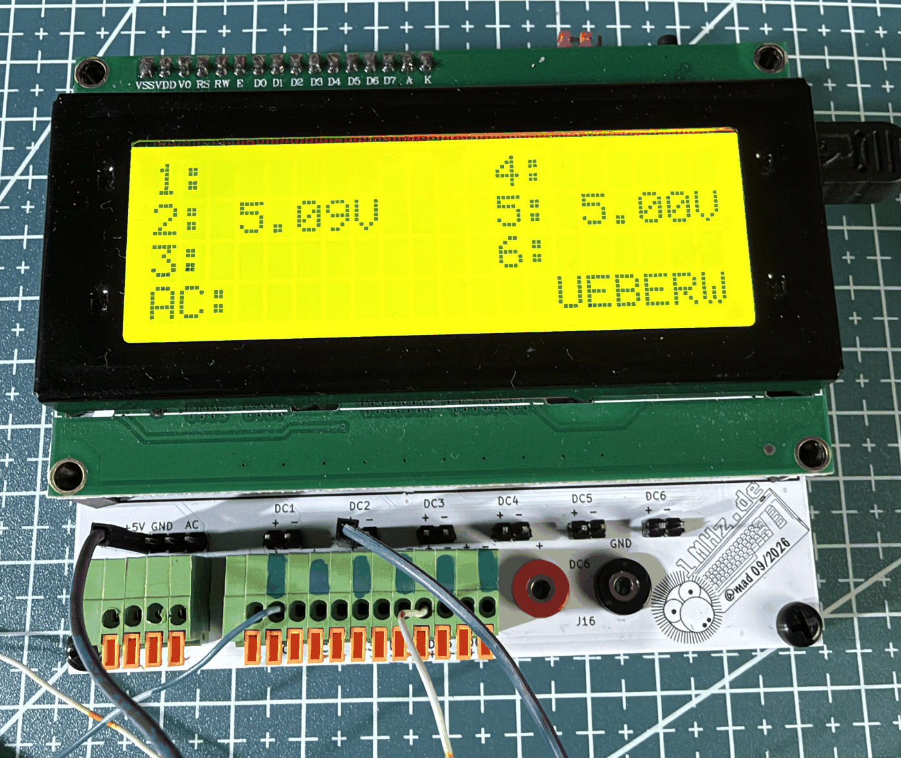

# Messsystem 6× DC + 1× AC

Ein kleines Messgerät für den Reparaturplatz: Es überwacht **sechs
Gleichspannungen (0–30 V)** und **eine Wechselspannung (9 V~)** gleichzeitig
und zeigt sie auf einem **20×4-LCD** an. Entstanden ist es, um die
Spannungsschienen eines Commodore-64 , Pet oder andere in einem Blick zu prüfen —
es passt aber auf jedes Gerät mit mehreren Versorgungsspannungen.

Projektseite und Diskussion: <https://1mhz.de>



*Startbild mit Firmware-Version. Unten die Eingänge: +5 V/GND/AC, DC1–DC6 als Klemmen und DC6 zusätzlich an 2-mm-Bananenbuchsen (J16).*



*Im Betrieb: zwei belegte Kanäle, die übrigen ausgeblendet. Rechts unten zeigt `UEBERW`, dass die Grenzwert-Überwachung aktiv ist.*

## Was es kann

- **7 Kanäle an einem ADC**: ein CD4051 schaltet die Eingänge auf einen
  einzigen ADC-Pin, ein MCP6004-Spannungsfolger entkoppelt den hochohmigen
  Teiler vom Sample-and-Hold.
- **Grenzwert-Überwachung**: Ein funktionierendes Gerät anschließen, Taste
  halten, Toleranz wählen — fertig. Fällt am Prüfling eine Schiene aus dem
  Bereich, meldet sich das Gerät mit Ton, blinkendem Hintergrundlicht und
  einem blinkenden Kanal im Display.
- **Kalibrierung mit zwei Punkten pro Kanal**, im EEPROM gespeichert.
- **Datenaufzeichnung** als CSV über die serielle Schnittstelle, mit
  Semikolon und Dezimalkomma — direkt in der Tabellenkalkulation brauchbar.
- **Serielle Konsole** für Kalibrierung, Grenzwerte und Diagnose.

## Technik in Stichworten

| | |
|---|---|
| MCU | ATmega328P, interner 8-MHz-Oszillator, kein Quarz |
| Multiplexer | CD4051 (8:1) auf ADC0 (PC0) |
| Puffer | MCP6004 (Rail-to-Rail, pinkompatibel zum LM324, **max. 6 V**) |
| Referenz | LM4040 4,096 V an AREF |
| Anzeige | HD44780 20×4, parallel im 4-Bit-Modus |
| DC-Eingänge | Teiler 1 MΩ / 100 kΩ (≈1:11), 100 nF, bipolare 1N4148-Klemme |
| AC-Eingang | Brückengleichrichter, Teiler 470 k / 150 k, Mittelwert → `Vrms = MW / 0,9` |
| Alarm | passiver Piezo (Reichelt EPM 121, 4 kHz) gegentaktig an PB6/PB7 über 330 Ω; Hintergrundlicht über Q1 (2N7000) an PB3 |
| Versorgung | 5 V über J9 oder USB-Mini J10 (nur eine Quelle gleichzeitig, kein Verpolschutz) |

## Bedienung

**Taster SW1 im Betrieb**

| Aktion | Wirkung |
|---|---|
| kurz tippen | Alarm stumm, bis er vorbei ist |
| ≥ 2 s halten | Grenzen einrichten, startet bei ± 1 % |
| im Einrichten tippen | Toleranz +1 % je Tipp (1…20, dann wieder 1) |
| im Einrichten 5 s warten | einlernen mit der gezeigten Toleranz, Wert wird gespeichert |
| ≥ 6 s halten | alle Grenzen löschen |
| beim Einschalten halten | Kalibriermodus |

Das Statusfeld unten rechts zeigt `UEBERW`, `ALARM!`, `STUMM`, beim Halten
`SETUP` bzw. `LOESCH` und im Einrichten die Toleranz, etwa `+- 7%`.

**Summer dauerhaft aus:** Jumper am ISP-Stecker J18 über Pin 1 und 3
(MISO gegen SCK). Zum Programmieren muss er ohnehin herunter.

**Serielle Konsole** (9600 Baud, `?` zeigt die Liste):
`l` Aufzeichnung · `r` Rohwerte · `s` Stopp · `1`–`6` / `a` kalibrieren ·
`g` / `G` Grenzen anzeigen/setzen · `e` einlernen · `t` Toleranz ·
`x` löschen · `m` stumm · `b` Summer-Test

## Firmware bauen und flashen

Arduino-IDE mit **MiniCore**: Board „ATmega328", Variante 328P,
Clock **Internal 8 MHz**, *No bootloader* → „Kompilierte Binärdatei
exportieren". Bibliothek `LiquidCrystal` ist im Core enthalten.

Fuses beim Brennen (z. B. TL866-II Plus, Xgpro, ATMEGA328P@DIP28):

```
Low = 0xE2    High = 0xD9    Ext = 0xFF   (0xFD für Brown-out 2,7 V)
```

Nach dem ersten Flashen einmal kalibrieren: beim Einschalten den Taster
gedrückt halten.

## Hardware

Das KiCad-Projekt liegt unter `hardware/kicad/` und bringt **alle benutzten
Symbole und Footprints als Projektbibliothek** mit (`libs/`, eingebunden über
`sym-lib-table` und `fp-lib-table`). Es lässt sich also ohne zusätzliche
Bibliotheken öffnen und bearbeiten. KiCad 10.

Die 3D-Modelle liegen vollständig in `hardware/kicad/packages3D/` – die
3D-Ansicht (Alt+3) ist nach dem Klonen sofort komplett, ohne weitere
Downloads.

Stückliste: `hardware/BOM.md` (mit Erklärungen) und `hardware/BOM.csv`.

## Stand

Aufgebaut, bestückt und im Einsatz. Die Versionsgeschichte mit allen
Entscheidungen, Messungen und Fallstricken steht in `CHANGELOG.md` —
auch die Geschichte vom gefälschten LM4040.

## Lizenz

MIT, siehe `LICENSE`. Nachbau, Änderung und Weitergabe sind ausdrücklich
erwünscht — über eine Rückmeldung im Forum freue ich mich.
